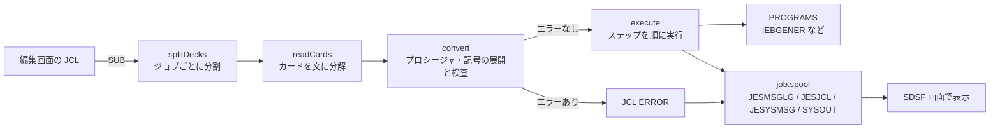

# プログラムの仕組み

JCL 練習端末の中身を、改造したい人向けに説明します。JavaScript の基本（関数、オブジェクト、配列）が分かれば読めます。

---

## 全体像

プログラムは `index.html` の1ファイルだけです。HTML・CSS・JavaScript がすべて入っていて、外部から読み込むのはフォント（Google Fonts）だけです。サーバーは使わず、すべてブラウザの中で動きます。

ジョブを投入（SUB）してから結果が出るまでの流れは、次のとおりです。



実機の z/OS でいうと、`convert` が JES2 の変換処理（コンバーター）、`execute` がイニシエーターによるステップの実行にあたります。

---

## ファイル内の構成

`index.html` の `<script>` の中は、上から次の順に並んでいます。エディタで `/* ====` や `/* ----` を検索すると、区切りの位置に移動できます。

| 区切り | 主な名前 | 役割 |
|---|---|---|
| sample members | `SAMPLES`、`PROCLIB`、`SYSPROCLIB` | サンプル JCL、USER01.PROCLIB と SYS1.PROCLIB の初期メンバー |
| helpers | `pad`、`lpad`、`hms`、`julian` | 文字列や日付の整形 |
| persistent state | `S`、`defaults()`、`save()` | 保存データ（カタログ・ジョブ・UNIX ファイル）の読み書き |
| JCL CONVERTER | `readCards`、`convert`、`VALIDATE`、`evalIf`、`condBypass` | JCL の解析・展開・検査、IF と COND の判定 |
| DATA SETS | `dsRead`、`dsWrite`、`newEntry`、`gdgGens` | データセットと GDG の操作 |
| PROGRAMS | `PROGRAMS` | `PGM=` で呼ばれるプログラムの本体 |
| JOB EXECUTION | `submitDeck`、`runJob`、`execute` | ジョブの受付、実行、出力（スプール）の作成 |
| SCREENS | `RENDER`、`HANDLE`、`render()`、`enter()`、`pf()` | 3270 画面の描画とキー入力の処理 |

---

## 保存データ

すべての状態は、変数 `S` に入っています。変更のたびに `save()` が呼ばれ、ブラウザの `localStorage`（キーは `jcl-terminal-v1`）に JSON で保存されます。

```js
S = {
  nextJob: 1234,          // 次に使うジョブ番号
  jobs: [ ... ],          // SDSF に出るジョブ（新しい順、最大40件）
  catalog: {              // カタログ。キーはデータセット名
    'USER01.JCL':  { dsorg:'PO', recfm:'FB', lrecl:80, members:{ HELLO:{lines:[...]}, ... } },
    'USER01.DATA': { dsorg:'PS', recfm:'FB', lrecl:80, lines:[ ... ], vol:'USER00' },
    'USER01.GDG':  { dsorg:'GDG', limit:3, scratch:true },     // GDG のベース
    'USER01.GDG.G0001V00': { dsorg:'PS', gdg:'USER01.GDG', lines:[ ... ] }
  },
  zfs: { '/u/user01/note.txt': { lines:[ ... ] } },           // z/OS UNIX ファイル
  seen: [ ... ]           // 追加済みのサンプル名（新しいサンプルを自動で入れるために使う）
}
```

データセットの中身は「1レコード = 文字列1つ」の配列です。

---

## JCL の解析（convert）

`convert(lines)` は1つのジョブの JCL を受け取り、次のオブジェクトを返します。

```js
{
  job: { stmt, steps:[ ... ], outputs, joblib, schedule },  // 実行するステップの一覧
  listing: [ ... ],   // JESJCL に表示する行
  errs:    [ ... ],   // { no:文番号, m:メッセージ, line:行, sev:'E'|'W'|'H' }
  hasErr:  true/false,
  jes2:    { ... }    // /*JOBPARM などの内容
}
```

処理は2段階です。

1. **`readCards`**: 80桁のカードを「文」に分けます。継続行をつなぎ、`DD *` のデータを取り込みます。この段階では記号（`&SYSUID` など）はまだ置き換えません。
2. **`convert` の本体**: 文を上から順に処理します。
   - 記号を置き換え（`substitute`）、JESJCL 用の行を作ります。
   - `EXEC` がプロシージャを呼んでいれば、`expandProc` で展開します。オーバーライドもここで適用します。
   - `INCLUDE` は、その場所にメンバーの中身を差し込みます（`spliceInclude`）。
   - キーワードと値は `KW` と `VALIDATE` で検査します。

エラーの重さ（`sev`）の意味は次のとおりです。

| sev | 意味 | ジョブへの影響 |
|---|---|---|
| `E` | JCL エラー | ジョブは実行されない |
| `W` | 警告（使われない記号など） | 実行される |
| `H` | JCK だけのヒント | JES の出力には出ない |

---

## プログラムを追加する

`PGM=名前` で呼ばれるプログラムは、`PROGRAMS` オブジェクトの関数です。関数は DD 文にアクセスするための引数 `c` を受け取り、戻りコードを返します。

| `c` のメンバー | 内容 |
|---|---|
| `c.has('DDNAME')` | その DD 文があるかどうか |
| `c.read('DDNAME')` | DD の中身を文字列の配列で返す（DD がなければ `null`） |
| `c.write('DDNAME', lines)` | DD に書き込む（SYSOUT なら出力に追加） |
| `c.log('メッセージ')` | JESMSGLG にメッセージを出す |
| `c.parm` | EXEC 文の `PARM=` の値 |
| `c.job` / `c.step` | ジョブ名とステップ名 |

戻り値は `{rc: 数字}` です。ABEND させたいときは `throw new Abend('S0C7','00000000',['ログに出す行'])` と書きます。

### 例: PARM の文字列を出力するプログラム

`PROGRAMS` の中に、次の関数を追加します。

```js
  ECHOPARM(c){
    if(!c.has('SYSPRINT')){ c.log('IEC130I SYSPRINT DD STATEMENT MISSING'); return {rc:12}; }
    c.write('SYSPRINT', ['PARM WAS: ' + (c.parm || '(NONE)')]);
    return {rc:0};
  },
```

ブラウザを再読み込みすると、次の JCL で使えるようになります。

```
//TEST     JOB (ACCT),'USER01',CLASS=A,MSGCLASS=X,NOTIFY=&SYSUID
//STEP1    EXEC PGM=ECHOPARM,PARM='HELLO WORLD'
//SYSPRINT DD SYSOUT=*
```

`REGION=` が小さすぎると S80A になるよう、必要なメモリ量を `PGM_STORAGE` に追加しておくこともできます（単位は K。省略すると制限なし）。

---

## 画面

画面は1つずつ「スクリーン」オブジェクトとして、スタック（`stack`）に積まれます。F3 で1つ戻るのは、スタックから1つ取り出す操作です。

| id | 画面 |
|---|---|
| `menu` | ISPF のメインメニュー |
| `util` | ユーティリティ選択（3） |
| `memlist` | メンバー一覧 |
| `edit` | 編集画面。1行ごとに行番号欄（`input.pfx`）とデータ欄（`input.dat`）がある |
| `dsu` | Data Set Utility（3.2） |
| `alloc` / `dsdel` / `dsren` / `dsinfo` | 3.2 の Allocate New Data Set / 削除の確認 / 名前変更 / データセット情報 |
| `dslp` | Data Set List Utility の入口（3.4） |
| `dslist` | データセット一覧（3.4 の結果） |
| `udlist` | z/OS UNIX ファイル一覧（3.17） |
| `sdsfmenu` / `st` / `dd` | SDSF のメニュー / ジョブ一覧 / 出力一覧 |
| `browse` | 出力やデータセットの表示。`live:'ulog'` / `live:'log'` なら SDSF の ULOG / SYSLOG |
| `tso` | `IKJ56250I` などが出る行モードの画面 |

画面を1つ追加するときは、次の3つを用意します。

1. `RENDER.画面id(sc)`: 画面の HTML を返す関数
2. `HANDLE.画面id(sc, cmd, raw, cur)`: Enter を押したときの処理。`cur` は Enter を押したときのカーソル位置
3. その画面を開く入口（たとえば `select()` にメニュー番号を追加する）

入力欄はすべて `input.f` で、3270 端末のように扱います。

- 文字は上書きで入り、欄の最後まで打つと次の欄へ移ります（`typeChar`）。Insert キーで挿入に切り替わります。
- 矢印キーは画面上の行と桁で移動先を決めます（`vertical`）。Tab は画面に見えている欄を順にたどります（`fields`）。
- 画面を描き直すときは `render()` が `sc.focus`（欄のキーと桁）にカーソルを戻します。編集画面で何も入力せずに Enter を押したときは、カーソルは元の位置に残ります。

編集画面の Enter は、`syncEdit()` で画面の内容をバッファに戻し、`edLines()` で行コマンドを処理してから、主コマンドを実行します。

SDSF のコマンド行で `/` から始まる入力は `sysCommand()` が処理します。`$` で始まれば `jes2Command()`、それ以外は MVS コマンドとして応答の行を作り、`ulog` と `syslog` に SYSLOG と同じ形式で記録します。ジョブの投入・開始・終了のメッセージも `runJob()` から `syslog` に入ります。コマンドを増やすときは、この2つの関数に分岐を足してください。

---

## 動作確認のしかた

テスト用のツールは使っていません。変更したら、次の手順で確認してください。

1. ブラウザで再読み込みし、画面が表示されることを確認する。表示されないときは、開発者ツール（F12）の Console にエラーが出ていないか見る。
2. 右側のガイドからすべてのサンプルを開き、`JCK` を実行する。エラー体験用のサンプル（BADJCL、SYNTAX、PROCERR）以外でエラーが出ないことを確認する。
3. いくつかのサンプルを `SUB` で投入し、結果が変わっていないことを確認する。
